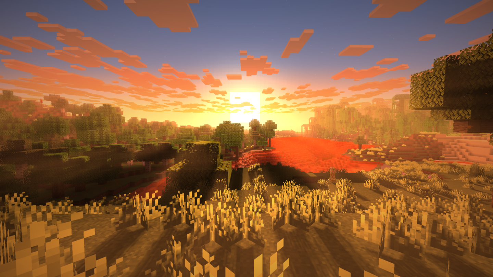
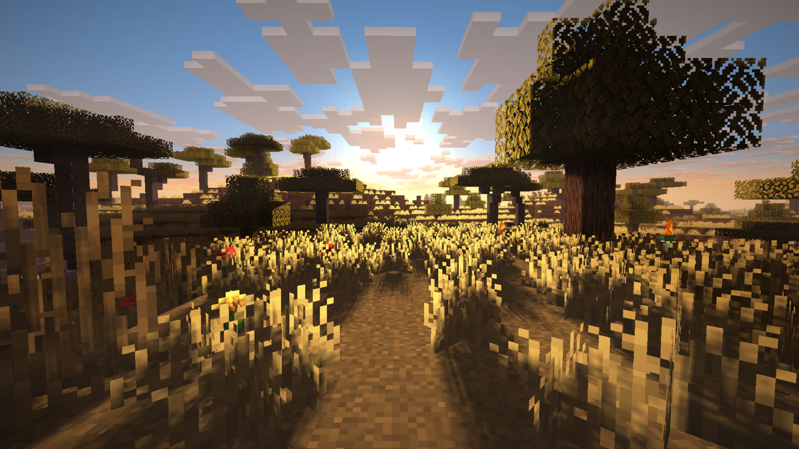
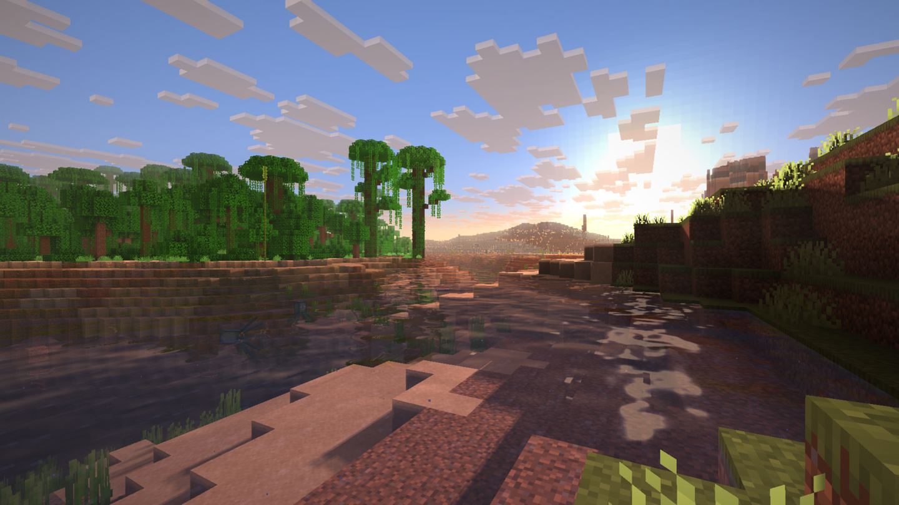
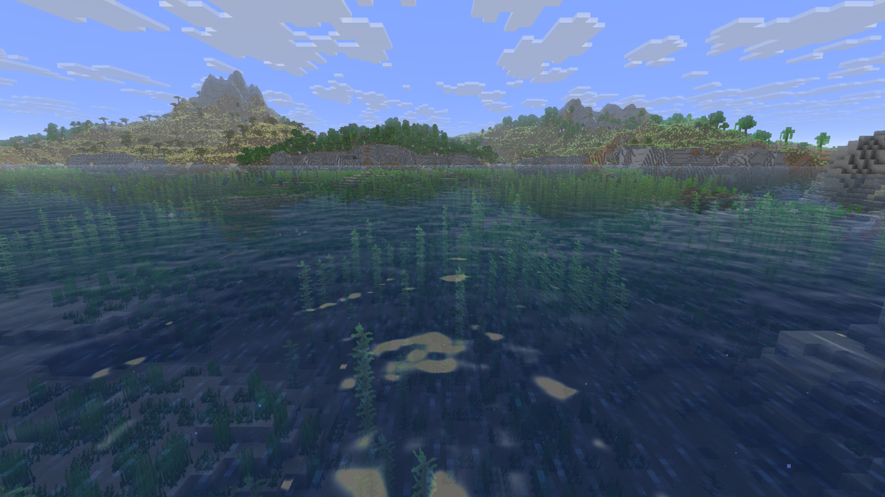
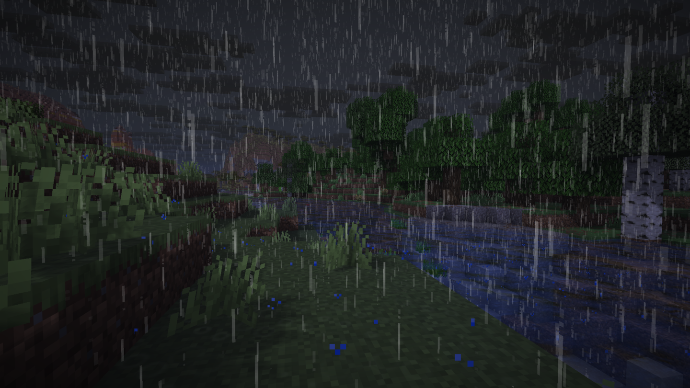
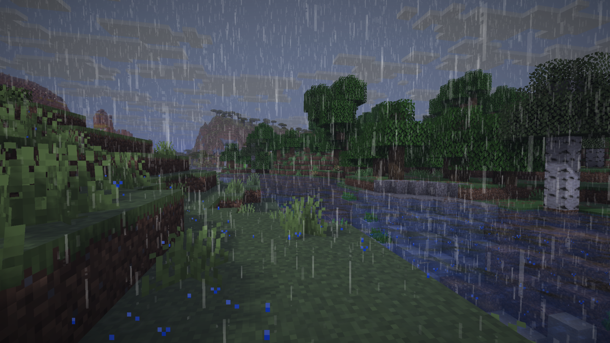
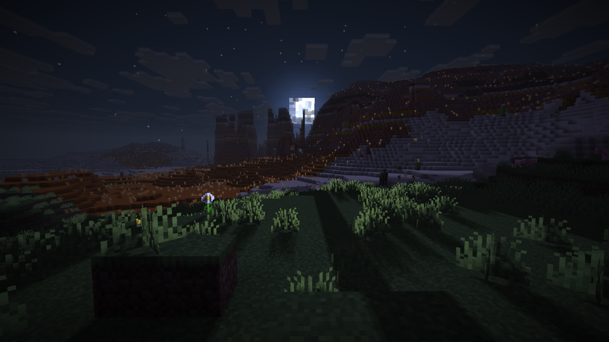
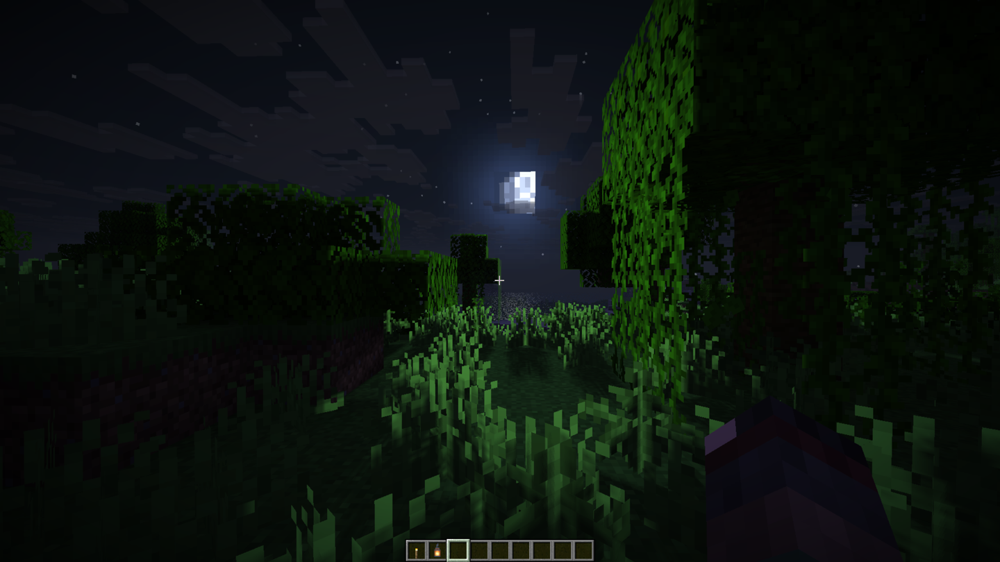
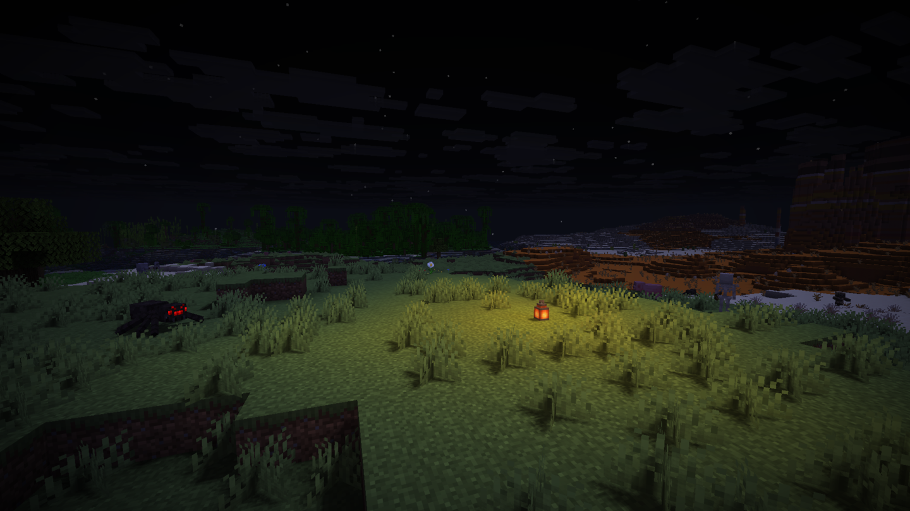
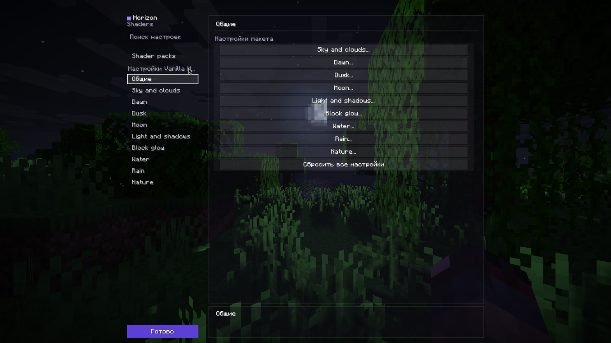

# Vanilla Horizon

**Vanilla Minecraft's light, plus real sunrises and sunsets, water and rain.**

A shader pack for [Horizon](https://playhorizon.dev) — the Rust rewrite of Minecraft: Java Edition.
Vanilla's own light is the base: the sun and the moon cast shadows on top of it, the blocks the low
sun reaches turn warm, rays spill across the horizon, and the air near the ground takes the hour's
colour. The water, the rain and the glowing blocks are the pack's own.

<p align="center">
  
  
  <br><sub><b>Magic dusks and dawns</b></sub>
</p>

<p align="center">
  
  
  <br><sub><b>Adjusting water transparency, waves, and reflections</b></sub>
</p>

<p align="center">
  
  
  <br><sub><b>Storm, strong wind</b> · <b>Rain, light breeze</b></sub>
</p>

<p align="center">
  
  
  <br><sub><b>Spellbinding moon light</b></sub>
</p>

<p align="center">
  
  <br><sub><b>The warm light of a lantern</b></sub>
</p>

<p align="center">
  
  <br><sub><b>Detailed settings</b></sub>
</p>

## Install

Horizon retired shader API 0.1 on 2026-11-15: every current build serves only **0.2**, and the
earlier 0.1 file is kept here for old builds and for the record.

| Your Horizon | Take |
| --- | --- |
| serves **0.2** — every build since 15.11.2026, and the launcher's own `--launch-api` | `dist/vanilla_horizon-2.11.1.hshader`, start the game with `HORIZON_HDR_FRAME=float` |
| serves **0.1** — e.g. nightly 13.11.2026 (archived) | `dist/vanilla_horizon-2.10.2.hshader` |

Both install the same way: Horizon → Options → Horizon Settings → Shader Packs → **Open Pack Folder**,
put the `.hshader` there, reopen the page, pick **Vanilla Horizon**. Do not keep two files of one id
in that folder — Horizon lists the first one and ignores the other.

The 0.2 build draws in linear light and passes the picture through the pack's own `[tonemap]`; its
`Tone curve` slider (0 = the game's own clip at white, 1 = the filmic curve) is the one to reach for
if the contrast does not feel like vanilla's.

## Releases, built by CI

Two workflows, no local tooling needed:

- `.github/workflows/check.yml` — on every push and pull request: `tools/check.py`, then Horizon's
  own check and package. It builds `horizon-shader` from the Horizon commit pinned in `tools/ci.py`
  (cached between runs) and uploads the packaged files as a build artifact.
- `.github/workflows/release.yml` — on a `v*` tag: verifies the tag against `version` in the
  manifest, checks, packages, and attaches the `.hshader` and the friend-ready zip to the release,
  with the notes taken from `docs/release-notes-<version>.md`.

So a release is:

```sh
# bump "version" in pack/horizon-shaders.toml, add docs/release-notes-<version>.md
git add -A && git commit -m "Vanilla Horizon <version>"
git tag -a v<version> -m "Vanilla Horizon <version>"
git push origin main v<version>
```

The registry takes a pack version straight from a release asset, so the tag, the manifest's
`version` and the file name all have to agree: `v2.11.1` → `vanilla_horizon-2.11.1.hshader`.

Both files come from the same packer the registry uses, so their SHA-256 match a local
`python3 tools/pack.py`.

## Passing it to someone else

Send `dist/vanilla-horizon-shader-2.10.2.zip`. The receiver unzips it into the Shader Packs folder,
reopens the page and picks **Vanilla Horizon** — `УСТАНОВКА.txt` inside the archive says the same in
Russian, including what not to do (renaming files inside the pack, dropping extra files into it, or
keeping both the folder and the `.hshader` of one id: Horizon refuses or duplicates the pack).

`dist/vanilla_horizon-2.10.2.hshader` is the other way round: a single file to drop in, no unzipping.

## Building

```
horizon-shader check pack     # authoritative: naga, SPIR-V/Metal/HLSL, every option at min and max
python3 tools/check.py        # fast pre-flight
python3 tools/pack.py         # dist/*.hshader + sha256, and the friend-ready .zip
```

`horizon-shader` comes from the Horizon repository:

```
cargo build -p horizon-shader-api --bin horizon-shader
```

`tools/pack.py` also points `~/.local/share/horizon/shaderpacks/vanilla_horizon` at `pack/` for hot
reload — it refuses to touch a link that already points somewhere else, so a checked-out copy never
hijacks a live install by accident (the last lines of its output will say so, and that is fine).

## Licence

MIT — see `LICENSE.txt` (also inside `pack/`, where Horizon expects it, with the Apache-2.0 notice and
text for the parts inherited from the Wisdom Shaders Horizon port).

The pack started as a fork of the unofficial Wisdom Shaders V3 Lite Horizon port (Wisdom Shaders V3
© bobcao3, Horizon port © tomasmendes01): the water's waves and the swaying of the plants come from
it and stay Apache-2.0, as its licence asks; the rest is MIT. The sun rays' march follows Petalveil
(MIT) by BarmaleyVIP.

Not an official Minecraft product. Not approved by or associated with Mojang or Microsoft.
